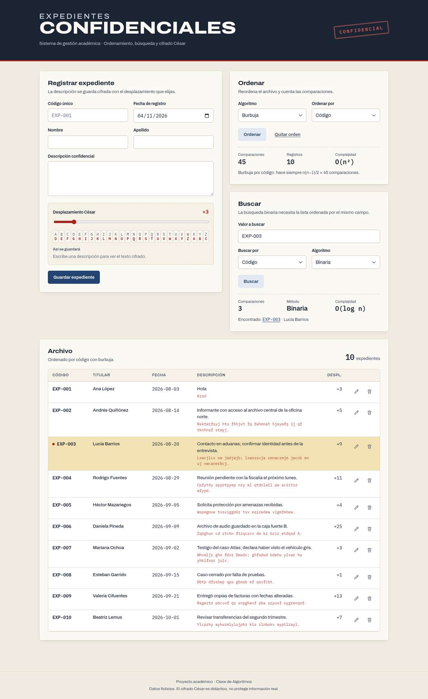
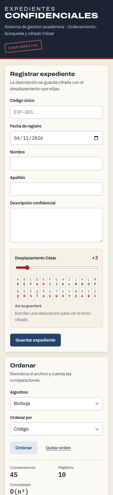

# Expedientes Confidenciales

Aplicación web en Flask para registrar expedientes ficticios y practicar los algoritmos del curso:

- **Ordenamiento:** burbuja y selección, contando las comparaciones.
- **Búsqueda:** secuencial y binaria, contando las comparaciones.
- **Cifrado César:** la descripción se guarda cifrada con un desplazamiento de 0 a 25 y se muestra descifrada.

Proyecto final de la clase de Algoritmos. Los datos son ficticios y el cifrado César es didáctico: no protege información real.

| Escritorio | Celular |
|---|---|
|  |  |

## Funciones

- Registrar, editar y eliminar expedientes (código único, nombre, apellido, fecha y descripción).
- Editar y eliminar se hacen dentro de la tabla: la fila se abre con el formulario o con la confirmación de borrado, sin cambiar de página ni usar ventanas del navegador. También funciona sin JavaScript.
- Vista previa del cifrado mientras escribes: una tira del alfabeto muestra cómo se reemplaza cada letra y resalta las que usa tu texto.
- Ordenar por código o por nombre, con el número de comparaciones y la fórmula n(n−1)/2.
- Buscar por código o por nombre. La búsqueda binaria exige ordenar antes por el mismo campo; el expediente encontrado se resalta en la tabla.
- Diseño responsive: en el celular la tabla se convierte en tarjetas.
- Los datos se guardan en `data/expedientes.json` y se escriben de forma atómica, para no dejar el archivo a medias.

## Requisitos

- Python 3.10 o superior

## Cómo correrlo

```bash
git clone https://github.com/dalvarez005/Proyecto_Final_Algoritmos.git
cd Proyecto_Final_Algoritmos

python -m venv .venv
source .venv/bin/activate        # En Windows: .venv\Scripts\activate
pip install -r requirements.txt

cd expedientes-confidenciales
flask --app app run
```

Abre <http://127.0.0.1:5000>.

### Variables de entorno (opcionales)

| Variable | Para qué sirve | Valor por defecto |
|---|---|---|
| `SECRET_KEY` | Firma la sesión de Flask (mensajes de aviso). Cámbiala fuera de tu computadora. | `clave-local-desarrollo` |
| `EXPEDIENTES_JSON` | Ruta del archivo de datos. | `data/expedientes.json` |
| `FLASK_DEBUG` | `1` activa el modo depuración al correr `python app.py`. | apagado |

## Pruebas

```bash
pip install -r requirements-dev.txt
cd expedientes-confidenciales
python -m pytest
```

Las pruebas cubren los algoritmos (cifrado, ordenamientos y búsquedas) y las rutas de la app (crear, editar, eliminar, ordenar, buscar, JSON dañado y migración de registros antiguos). GitHub Actions las corre en cada PR.

## Estructura

```
expedientes-confidenciales/
├── app.py                 # Rutas Flask, validación y almacenamiento JSON
├── algoritmos/
│   ├── ordenamiento.py    # Burbuja y selección
│   ├── busqueda.py        # Secuencial y binaria
│   └── cesar.py           # Cifrar y descifrar
├── data/expedientes.json  # Datos (se crea si no existe)
├── static/
│   ├── estilos.css
│   └── app.js             # Vista previa del cifrado y paneles de editar/eliminar
├── templates/
│   ├── base.html
│   ├── _campos.html       # Campos compartidos por registrar y editar
│   └── index.html
└── tests/
```

## Complejidad

| Algoritmo | Comparaciones | Notas |
|---|---|---|
| Burbuja | n(n−1)/2, siempre | O(n²). No se detiene antes aunque la lista ya esté ordenada. |
| Selección | n(n−1)/2, siempre | O(n²). Hace como máximo n−1 intercambios. |
| Búsqueda secuencial | hasta n | O(n). Funciona con la lista en cualquier orden. |
| Búsqueda binaria | hasta ⌊log₂ n⌋ + 1 | O(log n). Requiere la lista ordenada por el campo buscado. |
| Cifrado César | — | O(k) para un texto de k caracteres. Solo desplaza letras A–Z sin acento; la ñ, los acentos y los números quedan igual. |

## Licencia

MIT. Ver [LICENSE](LICENSE).
