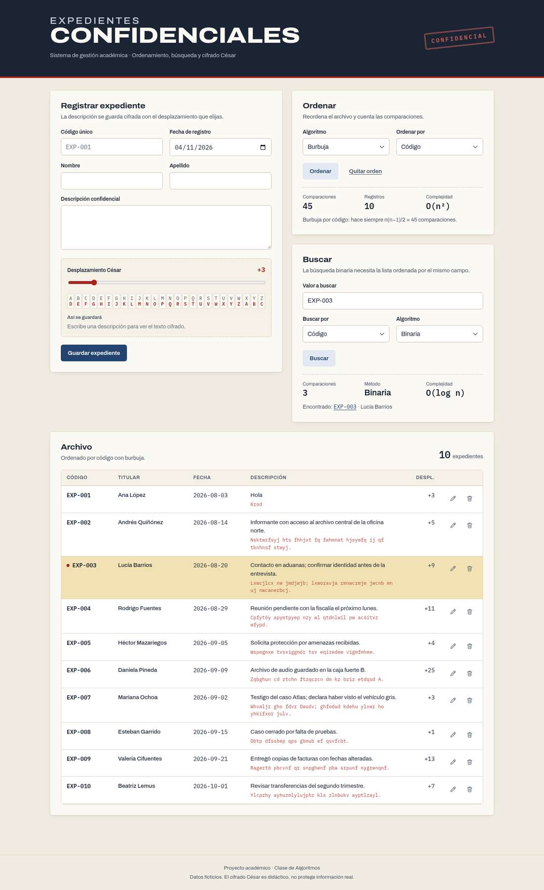
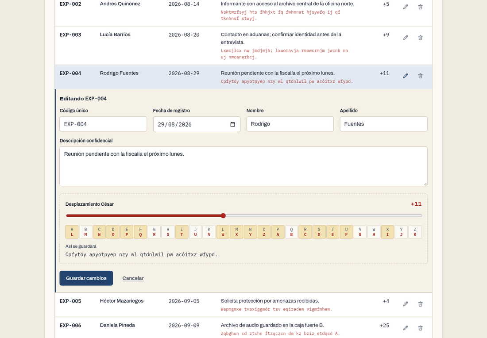
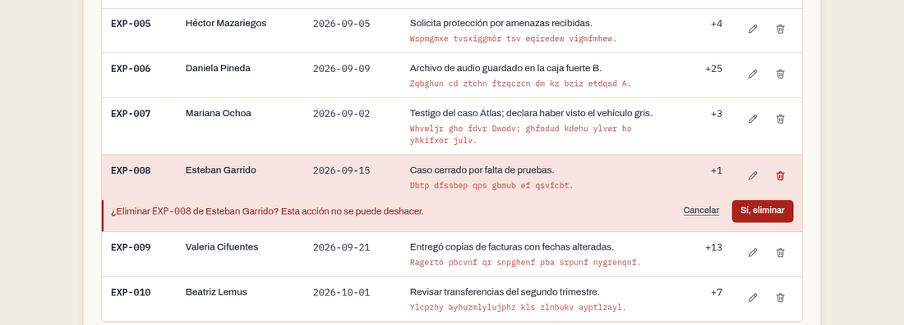
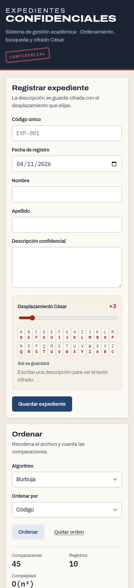

# Sistema Web de Expedientes Confidenciales — Documentación

Proyecto final de Algoritmos · Universidad Mariano Gálvez de Guatemala · Facultad de Ingeniería en Sistemas de Información y Ciencias de la Computación · Catedrático: Ing. David Olivier Díaz Hidalgo

## 1. Integrantes y foto del grupo

| Nombre | Carné |
|---|---|
| Edgar Geovanni Patzán Santos | 7690-26-5908 |
| Diego Ricardo Álvarez Castañeda | 7690-26-2493 |
| Carlos Vinicio Camas | 7690-26-12538 |
| Maynor Iván Guerra Chávez | 7690-26-9413 |


## 2. Propuesta de valor

**Para** oficinas que manejan expedientes sensibles (fiscalías, recursos humanos, investigación interna) y para estudiantes que aprenden algoritmos, **Expedientes Confidenciales** es una aplicación web que registra, organiza y encuentra expedientes guardando su descripción cifrada.

- **Ordena y encuentra rápido.** Ordena por código o nombre y busca de forma secuencial o binaria, mostrando cuántas comparaciones hizo cada algoritmo. Así se ve en la práctica por qué la búsqueda binaria es más eficiente.
- **La descripción no se guarda en texto plano.** Cada expediente tiene su propio desplazamiento César y la app muestra en vivo cómo queda cifrado. Es didáctico: César no ofrece seguridad real.
- **Sin instalar una base de datos.** Los datos viven en un archivo JSON que se puede revisar, respaldar y compartir.
- **Funciona en cualquier dispositivo.** Se usa desde el navegador, en computadora o celular.

## 3. Cumplimiento de requisitos

| Requisito del enunciado | Cómo se cumple | Dónde |
|---|---|---|
| Aplicación web accesible desde navegador | Flask + HTML/CSS; diseño responsive | `app.py`, `templates/` |
| Expediente: código único, nombre, apellido, fecha, descripción | Formulario con todos los campos obligatorios | `templates/_campos.html` |
| Crear · consultar · editar · eliminar | Registro, tabla y búsqueda, edición y borrado dentro de la tabla | `app.py` (`crear`, `inicio`, `editar`, `eliminar`) |
| Leer y guardar en JSON, sin base de datos | `cargar_expedientes()` y `guardar_expedientes()` | `data/expedientes.json` |
| Persistencia tras reiniciar | Cada cambio se escribe al JSON (escritura atómica) | prueba `test_los_datos_persisten_tras_reiniciar` |
| Validaciones: código duplicado | Compara sin distinguir mayúsculas | `buscar_por_codigo()` |
| Validaciones: archivo vacío o inválido | Mensaje de error sin que la app se caiga | `cargar_expedientes()` |
| Validaciones: campos obligatorios | Se valida en el servidor (y en el navegador) | `leer_formulario()` |
| Burbuja y selección, por código o nombre | Implementados a mano | `algoritmos/ordenamiento.py` |
| Mostrar número de comparaciones | Se muestra tras ordenar y tras buscar | `templates/index.html` |
| No usar `sort()` ni `sorted()` | No se usan en ninguna parte del código | — |
| Búsqueda secuencial y binaria | Implementadas a mano | `algoritmos/busqueda.py` |
| Binaria exige orden previo por el campo buscado | Si no se cumple, muestra un aviso y no busca | `pagina_inicio()` |
| Buscar código existente e inexistente | Ambos casos muestran resultado y comparaciones | sección 5.2 |
| César con desplazamiento configurable y reversible | Desplazamiento 0–25 por expediente; `descifrar` revierte | `algoritmos/cesar.py` |
| Solo datos ficticios | El JSON de ejemplo es inventado | `data/expedientes_ejemplo.json` |
| JSON de ejemplo | 10 expedientes ficticios | `data/expedientes_ejemplo.json` |
| Guía de instalación y ejecución | README | `README.md` |

## 4. Explicación de algoritmos y decisiones

### 4.1 Ordenamiento burbuja

Recorre la lista comparando cada par de elementos vecinos y los intercambia si están en desorden. Tras cada pasada, el mayor de lo que queda "sube" al final, así que la siguiente pasada revisa un elemento menos.

- Comparaciones: siempre `n(n−1)/2` (con 10 expedientes, 45).
- Complejidad: O(n²).

### 4.2 Ordenamiento por selección

En cada paso busca el menor de la parte sin ordenar y lo coloca en su posición con un solo intercambio.

- Comparaciones: siempre `n(n−1)/2`.
- Hace como máximo `n−1` intercambios, menos que burbuja.
- Complejidad: O(n²).

### 4.3 Búsqueda secuencial

Revisa los expedientes uno por uno hasta encontrar el valor o terminar la lista. Funciona con la lista en cualquier orden.

- Comparaciones: de 1 a `n`.
- Complejidad: O(n).

### 4.4 Búsqueda binaria

Compara con el elemento del medio y descarta la mitad donde no puede estar el valor; repite con la mitad restante. Solo es correcta si la lista está ordenada por el mismo campo que se busca, por eso la app la bloquea si no se cumple.

- Comparaciones: como máximo `⌊log₂ n⌋ + 1` (con 10 expedientes, 4).
- Complejidad: O(log n).

### 4.5 Cifrado César

Cada letra se reemplaza por la que está `d` posiciones más adelante en el alfabeto, dando la vuelta de la Z a la A. Ejemplo del enunciado: `HOLA` con +3 → `KROD`. Para descifrar se aplica el mismo algoritmo con `−d`.

- Se respetan mayúsculas y minúsculas.
- Solo se desplazan las letras A–Z sin acento; la ñ, los acentos, los números y los signos quedan igual.

### 4.6 Decisiones de diseño

| Decisión | Motivo |
|---|---|
| Flask y Python | Sintaxis cercana al pseudocódigo del curso; servidor web en pocas líneas. |
| Algoritmos en `algoritmos/`, separados de la web | Se pueden leer, probar y explicar sin depender de Flask. |
| Comparación sin distinguir mayúsculas (`casefold`) | "ana" y "Ana" deben ordenarse y encontrarse igual. |
| Los algoritmos devuelven una copia ordenada | Ordenar para mostrar no altera el orden guardado en el archivo. |
| Desplazamiento guardado en cada expediente | Cada registro puede tener su propia clave y siempre se puede descifrar. |
| Escritura atómica del JSON (archivo temporal + reemplazo) | Si algo falla al guardar, el archivo original no queda a medias. |
| Registros antiguos sin desplazamiento se migran con +3 | Compatibilidad con datos creados antes de agregar ese campo. |
| Editar y eliminar dentro de la tabla, sin ventanas del navegador | Menos pasos para el usuario y una confirmación clara antes de borrar. |

## 5. Evidencia de pruebas de aseguramiento de calidad

### 5.1 Pruebas automáticas (pytest)

17 pruebas, todas aprobadas. GitHub Actions las ejecuta en cada PR.

```
tests/test_algoritmos.py::test_cesar_ida_y_vuelta PASSED
tests/test_algoritmos.py::test_cesar_da_la_vuelta_al_alfabeto PASSED
tests/test_algoritmos.py::test_ordenamientos_coinciden_y_no_mutan PASSED
tests/test_algoritmos.py::test_ordenar_listas_cortas PASSED
tests/test_algoritmos.py::test_busqueda_secuencial PASSED
tests/test_algoritmos.py::test_busqueda_binaria PASSED
tests/test_app.py::test_inicio_vacio PASSED
tests/test_app.py::test_crear_guarda_cifrado PASSED
tests/test_app.py::test_crear_rechaza_duplicado_y_datos_invalidos PASSED
tests/test_app.py::test_editar_y_eliminar PASSED
tests/test_app.py::test_ordenar_y_buscar PASSED
tests/test_app.py::test_json_corrupto_y_migracion PASSED
tests/test_app.py::test_editar_con_error_conserva_lo_escrito PASSED
tests/test_app.py::test_eliminar_vuelve_a_la_misma_vista PASSED
tests/test_app.py::test_archivo_vacio_muestra_error PASSED
tests/test_app.py::test_los_datos_persisten_tras_reiniciar PASSED
tests/test_app.py::test_json_de_ejemplo_es_valido PASSED
============================== 17 passed ==============================
```

Para repetirlas: `pip install -r requirements-dev.txt`, luego `cd expedientes-confidenciales` y `python -m pytest -v`.

### 5.2 Casos de prueba funcionales

Ejecutados sobre `data/expedientes_ejemplo.json` (10 expedientes, guardados en desorden a propósito).

| # | Caso | Entrada | Resultado esperado | Resultado obtenido | Estado |
|---|---|---|---|---|---|
| 1 | Ordenar por código con burbuja | Burbuja · Código | EXP-001 … EXP-010, 45 comparaciones | EXP-001 … EXP-010, 45 comparaciones | ✅ |
| 2 | Ordenar por nombre con selección | Selección · Nombre | Ana, Andrés, Beatriz … Valeria; 45 comparaciones | Igual; 45 comparaciones | ✅ |
| 3 | Búsqueda secuencial, código existente | `EXP-003` | Encontrado | Encontrado, 8 comparaciones (está en la posición 8) | ✅ |
| 4 | Búsqueda secuencial, código inexistente | `EXP-099` | No encontrado | No encontrado, 10 comparaciones | ✅ |
| 5 | Búsqueda binaria sin ordenar | `EXP-003` | Aviso: primero ordenar | «Primero ordena los expedientes…» | ✅ |
| 6 | Búsqueda binaria ordenada por otro campo | Orden por nombre, buscar código | Aviso: mismo campo | «Ordena por el mismo campo…» | ✅ |
| 7 | Búsqueda binaria, código existente | Orden por código · `EXP-003` | Encontrado en ≤ 4 comparaciones | Encontrado, 3 comparaciones | ✅ |
| 8 | Búsqueda binaria, código inexistente | Orden por código · `EXP-099` | No encontrado en ≤ 4 comparaciones | No encontrado, 4 comparaciones | ✅ |
| 9 | Búsqueda binaria por nombre | Orden por nombre · `lucía` | Encontrado sin importar mayúsculas | EXP-003, 4 comparaciones | ✅ |
| 10 | Cifrado del enunciado | `HOLA`, +3 | `KROD` | `KROD` | ✅ |
| 11 | Descifrar | Texto cifrado con +25 | Texto original | Texto original | ✅ |
| 12 | Código duplicado | Registrar `exp-001` existiendo `EXP-001` | Rechazado | «El código exp-001 ya existe.» | ✅ |
| 13 | Campos obligatorios | Código vacío | Rechazado | «Todos los campos son obligatorios.» | ✅ |
| 14 | Desplazamiento fuera de rango | 30 | Rechazado | «El desplazamiento debe estar entre 0 y 25.» | ✅ |
| 15 | Archivo vacío | `expedientes.json` sin contenido | Mensaje, la app no se cae | «El archivo expedientes.json está vacío o tiene formato inválido.» | ✅ |
| 16 | JSON inválido | `{malo` | Mensaje, la app no se cae | Mismo mensaje | ✅ |
| 17 | Persistencia | Registrar y volver a leer el archivo | El registro sigue ahí | El registro sigue ahí, cifrado | ✅ |
| 18 | Editar con error | Cambiar a un código ya usado | Aviso en la fila, conserva lo escrito | Aviso en la fila y datos conservados | ✅ |
| 19 | Eliminar | Papelera → «Sí, eliminar» | Se borra tras confirmar en la fila | Se borra; sin ventanas del navegador | ✅ |
| 20 | Vista en celular (390 px) | — | Sin desplazamiento horizontal | Tabla en tarjetas, sin desborde | ✅ |

### 5.3 Capturas

**Ordenado por código con burbuja y búsqueda binaria de `EXP-003`**



**Edición dentro de la tabla, con vista previa del cifrado**



**Confirmación de borrado en la fila**



**Celular**



## 6. Guion sugerido para la demostración

1. Abrir la app y mostrar los 10 expedientes de ejemplo, en desorden.
2. Registrar un expediente con descripción `HOLA` y desplazamiento +3; mostrar que se guarda `KROD`.
3. Intentar registrar el mismo código: aparece el aviso de duplicado.
4. Ordenar por código con burbuja y luego por nombre con selección; comparar las comparaciones (45 en ambos).
5. Buscar `EXP-003` de forma secuencial (8 comparaciones) y luego binaria con la lista ordenada (3 comparaciones).
6. Buscar `EXP-099` (inexistente) con ambos métodos.
7. Intentar la búsqueda binaria sin ordenar: aparece el aviso.
8. Editar un expediente y cambiar su desplazamiento; mostrar el nuevo texto cifrado.
9. Eliminar un expediente con la confirmación en la fila.
10. Reiniciar el servidor y mostrar que los datos siguen ahí.
